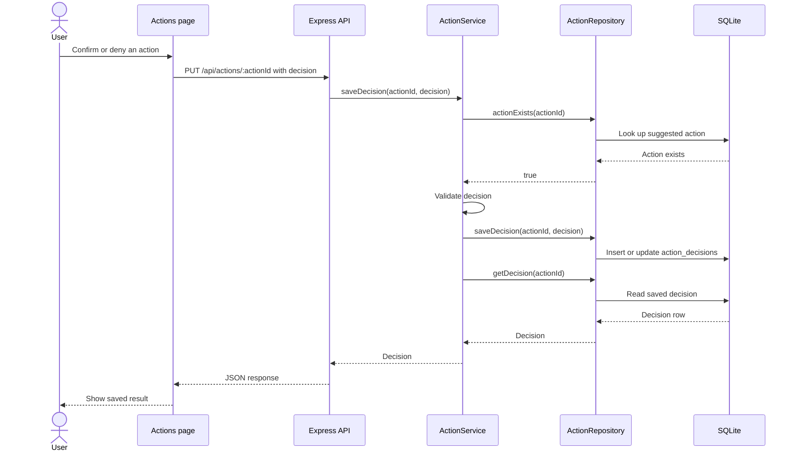

# Suggested Action Decision: Sequence Diagram

This diagram describes a successful confirm or deny request. The application
records a decision; it does not send a message or create an external task.

An unknown action ID or invalid decision produces a validation error. The
page displays an error if saving fails. The API permits updating an existing
decision, even though the page disables the buttons after a successful save.
