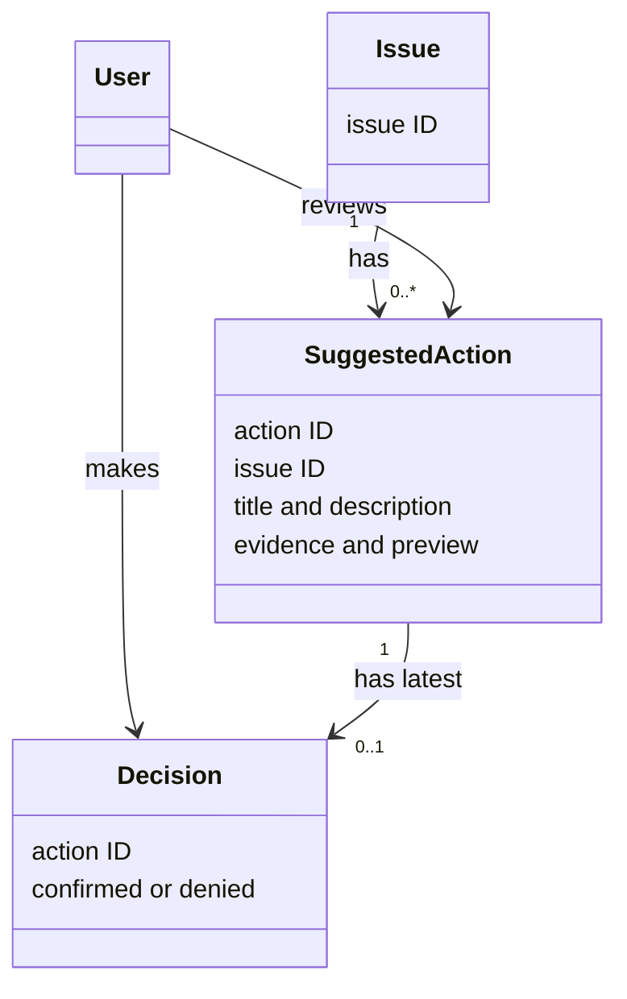

# Actions: Conceptual Class Diagram

This is a problem-level model, not a diagram of JavaScript classes.

Sample suggested actions are stored in SQLite and retrieved for an issue.
Decisions are stored by action ID, without user identity or decision history.
User and Decision are concepts, not persisted user accounts or separate
JavaScript classes. No external action is performed.
