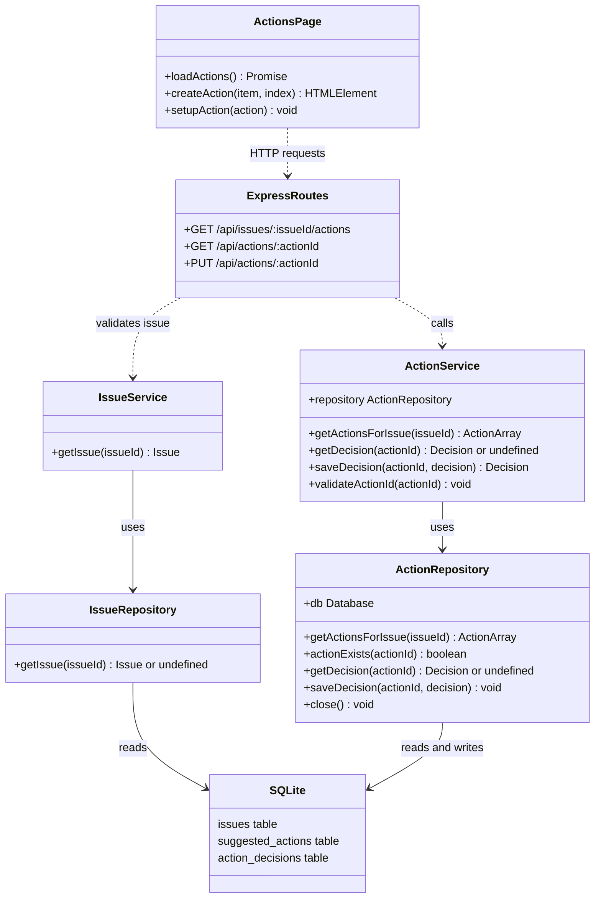

# Actions: Detailed Class Diagram

This describes the current implementation. JavaScript does not enforce the
types shown. `ActionsPage` and `ExpressRoutes` represent functions and routes,
not actual JavaScript classes.

The service receives its repository through its constructor; no formal
repository interface is currently defined. `ActionArray` and `Decision` are
plain JavaScript values, not defined classes. Issue validation is performed by
`IssueService` before the actions listing route invokes `ActionService`.
