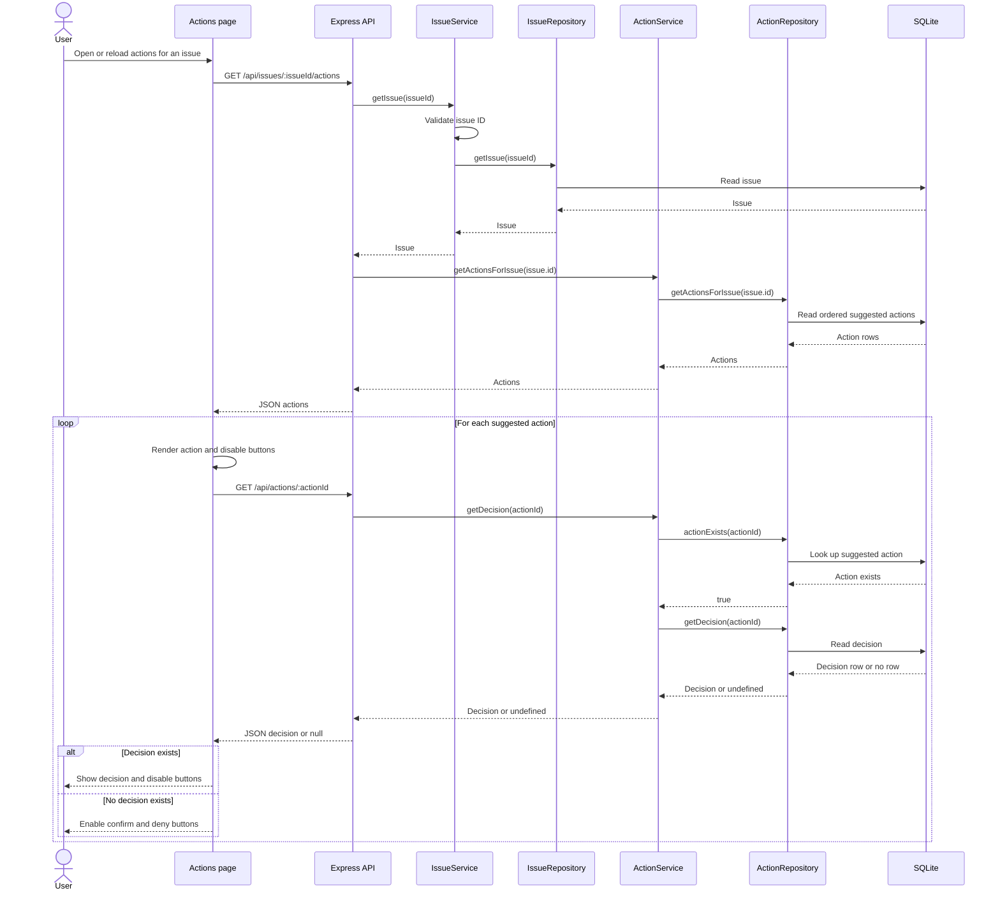

# Actions: Load Suggestions and Decisions Sequence Diagram

This is the successful load flow. Decision lookup is repeated for each
suggested action returned for the requested issue.

If no actions are returned, the page displays an empty-state message. If
loading actions or a decision fails, the page displays an error; decision
buttons remain disabled when their state cannot be loaded.
